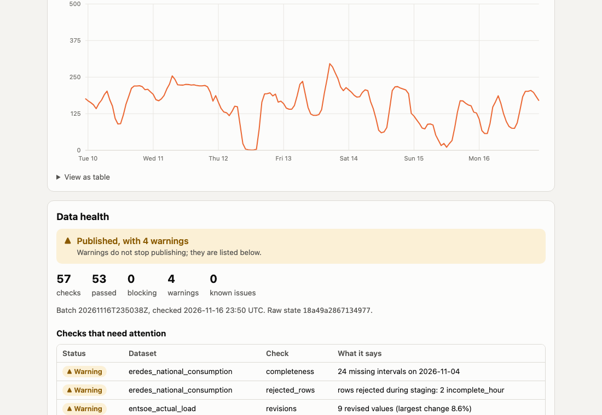
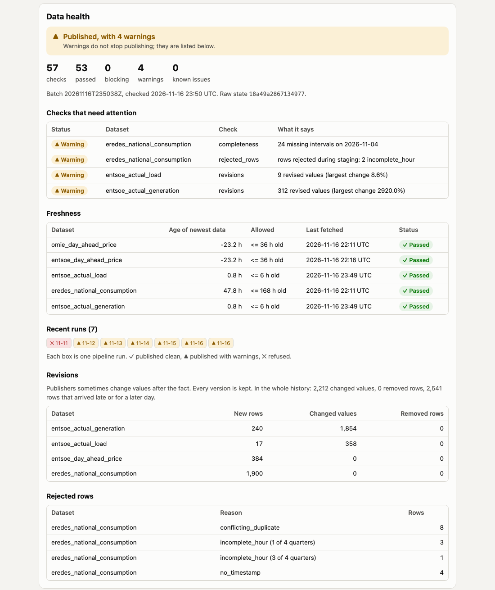
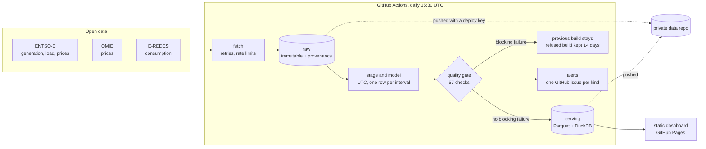
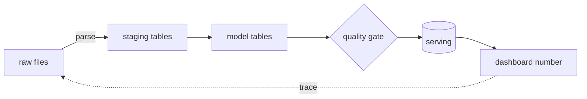

# pt-energy-pipeline

[](https://github.com/cardohso/pt-energy-pipeline/actions/workflows/ci.yml)
[](https://github.com/cardohso/pt-energy-pipeline/actions/workflows/pipeline.yml)

A small, scheduled batch pipeline over open Portuguese electricity data: generation by source, demand
and day-ahead prices. It is built to read like a production pipeline: data contracts, immutable raw
files with provenance, a quality gate that can refuse to publish, lineage from a dashboard number back
to its raw file, alerts, and a public dashboard with a data-health panel.

**Live dashboard: <https://cardohso.github.io/pt-energy-pipeline/>**

## In 30 seconds

- **What it does.** Every day GitHub Actions fetches ENTSO-E, OMIE and E-REDES data, keeps every raw
  file exactly as received, rebuilds three modelled tables, runs 57 quality checks, and publishes only
  if no *blocking* check failed. If one fails, the previous good build stays up and an issue opens.
- **Contracts.** Each of the five source datasets has a versioned YAML contract (owner, grain, key,
  time zone, units, ranges, freshness, licence, changelog). CI fails on an unversioned change.
- **Reruns are safe.** Raw files are content-addressed, so a rerun or a 30-day backfill never
  duplicates anything, and a changed value from a publisher is stored as a new version, not
  overwritten.
- **Traceable.** Each headline number on the dashboard has a *Trace to raw files* button that lists
  the exact raw files (path, fetch time, contract version, SHA-256) behind it.
- **Honest.** The dashboard's data-health panel shows the quality gate's own report, warnings
  included. [Limitations](#limitations) and [lessons](#lessons-from-running-it) below say what did not
  work.

Status is on the [Actions tab](https://github.com/cardohso/pt-energy-pipeline/actions): the
scheduled run started on 2026-11-12. The cron is 15:30 UTC; GitHub often starts it hours late, and
one run (2026-11-15) failed on a single unretried HTTP 599 response. Nothing here claims an uptime figure.

## Dashboard





The page is static HTML, CSS and JavaScript with no libraries and no external requests. See
[docs/dashboard.md](docs/dashboard.md).

## Architecture



- **Raw** is the source of truth: `raw/<source>/<dataset>/<day>/<content hash>.<ext>` plus a
  `.meta.json` with URL, parameters, HTTP status, fetch time, SHA-256, pipeline version and contract
  version. Details: [docs/ingestion.md](docs/ingestion.md).
- **Model** tables: `generation_by_source`, `demand`, `day_ahead_price`, one row per interval in UTC,
  plus meta tables (lineage, revisions, rejected rows, check results). Details:
  [docs/data-model.md](docs/data-model.md).
- **Why a private data repository.** The raw ENTSO-E files are not on its open-licence list, so they
  are not republished. The dashboard shows aggregates with attribution. See
  [docs/decisions.md](docs/decisions.md) for this and for why there is no Dagster.

## Lineage



The full diagram, generated from the pipeline definition (and checked in CI so it cannot go stale),
is in [docs/lineage.md](docs/lineage.md). Every model row carries `raw_sha256`; joining it to
`meta.lineage` gives the raw file. The dashboard export does exactly that for each headline number,
and the tests recompute a number independently and check that the listed files exist and hash to the
values shown. Each run also writes [OpenLineage](https://openlineage.io) events to the data
repository.

## Data contracts

One YAML file per source dataset in [`contracts/`](contracts/), validated against a JSON Schema.

| Contract | Version | Notes |
|---|---|---|
| `omie_day_ahead_price` | 3.0.0 | OMIE moved from hourly to 15-minute prices on 2025-10-01; a field rename was a breaking change with a migration |
| `eredes_national_consumption` | 1.1.0 | CC BY 4.0 |
| `entsoe_actual_generation` | 1.1.0 | hourly, per production type and direction |
| `entsoe_actual_load` | 1.1.0 | hourly |
| `entsoe_day_ahead_price` | 1.1.0 | 15-minute |

- A contract change is classified as major (breaking), minor or patch. CI compares each contract with
  its frozen history (`contracts/history`, `LOCK.json`) and fails if a change did not bump the
  version, a breaking change has no migration, or a frozen version was edited.
- Types, ranges, nullability, allowed values and the primary key are enforced at run time from the
  contracts, not from code: a [Pandera](https://pandera.readthedocs.io) schema is generated from each
  contract.
- Details: [docs/contracts.md](docs/contracts.md).

## Quality checks and why

Thresholds are in [`contracts/quality/rules.yaml`](contracts/quality/rules.yaml). A *blocking* failure
refuses the build; a *warning* publishes and is shown on the dashboard.

| What is checked | Why | Blocks? |
|---|---|---|
| Parse errors, schema, nulls, ranges, primary key (from the contracts) | a publisher changed a format, unit or column | yes |
| Freshness and completeness | a feed stopped, or a day or a series is missing | yes for ENTSO-E and OMIE; E-REDES never blocks |
| Price cross-check: OMIE against ENTSO-E | two publishers should agree on the same price | yes |
| Demand cross-check: ENTSO-E against E-REDES | catches unit and time-zone errors | warning above 4% a day, blocking above 10% |
| Drift against a 14-day robust baseline | silent scale changes | yes for load and generation, warning for price |
| Frozen values | a stuck sensor or feed | yes for load, warning for E-REDES |
| E-REDES total against the sum of its parts | internal consistency | warning |
| Rejected rows, revisions | publisher defects and late corrections | warning |

Known publisher defects can be excused per day in `contracts/quality/known_issues.yaml`, in a
reviewed pull request. Details and tolerances: [docs/quality.md](docs/quality.md).

**What proves the gate works:**

- A synthetic world (five consistent feeds, 40 days, the publishers' real time quirks) is run through
  the whole pipeline; each planted bad batch (a truncated day, a missing day of prices, a spike, a
  wrong unit, a renamed field, stale feeds, and others) is caught by the right check. The main checks
  were mutation-tested: switching one off makes its test fail.
- On the real data, changing one price in a real raw ENTSO-E file to 99999 blocked the build, kept
  the previous `serving/` byte-identical, and listed the failing check and day in the report.
- On GitHub, the very first build was refused by the freshness check and opened an issue by itself
  (see lessons).

## Revision policy

Publishers revise past values, so the rule is **version, then flag; never overwrite, never ignore**.

1. Raw files are immutable. A changed window is stored next to the old one and linked to it.
2. Every daily run refetches the last 7 days, so late corrections are caught within a week.
3. The model uses the newest version and keeps old values in `meta.revisions`.
4. Rows that did not exist before (tomorrow's prices, a partial day filling in) are growth, not
   revisions. For ENTSO-E load and generation, a day warns if its revisions add up to more than 10% of
   its total. Any changed or removed day-ahead price opens an issue, because those should be final.

Why not overwrite: it loses the audit trail. Why not only flag: a flag without the old values cannot
be investigated. Details: [docs/ingestion.md](docs/ingestion.md).

## Run it

```bash
python -m venv .venv && source .venv/bin/activate
pip install -e ".[dev]"
cp .env.example .env          # fill in ENTSOE_API_TOKEN yourself; OMIE and E-REDES need no key
```

```bash
pt-energy daily --lookback 7                          # fetch the last 7 days into data/raw
pt-energy transform                                   # build tables, run the gate, publish or refuse
pt-energy dashboard build --out site                  # static dashboard from the published tables
```

Backfill a date range (safe to rerun, nothing is duplicated):

```bash
pt-energy backfill --start 2026-10-12 --end 2026-11-10
```

On GitHub the same commands run in the [`Pipeline` workflow](.github/workflows/pipeline.yml), on a
schedule or by hand (`mode=backfill`, `start`, `end`). Setup of the private data repository, deploy
key and secrets, and what each alert means: [docs/operations.md](docs/operations.md).

Checks (all of this runs in CI, with no network):

```bash
ruff check . && ruff format --check . && mypy && pytest
```

## Repository map

| Path | What |
|---|---|
| `src/pt_energy/ingest` | HTTP with retries, per-source adapters, the raw store |
| `src/pt_energy/transform` | parsers, staging, modelled tables |
| `src/pt_energy/quality` | contract checks, SQL checks, the gate |
| `src/pt_energy/lineage` | generated diagram, OpenLineage events |
| `src/pt_energy/dashboard` | the export behind the page; the page itself is in `dashboard/` |
| `contracts/` | contracts, frozen history, migrations, quality rules |
| `docs/` | one document per topic |
| `tests/` | no network; real fixtures for OMIE and E-REDES, a synthetic world for the rest |

## Limitations

- **Thresholds come from about a month of autumn data.** Summer solar, spring negative prices and
  holidays are not in it, so expect some warnings to need tuning.
- **Scheduling is not exact.** GitHub starts scheduled runs late (observed: more than 8 hours late once) and
  disables them after 60 days without repository activity. Nothing depends on the minute.
- **One publisher outage can pause publishing.** A stale ENTSO-E feed blocks the whole build. That is
  deliberate: loud and simple.
- **The sources are not independent.** ENTSO-E and E-REDES both republish REN's load, so the demand
  check finds publishing and unit errors, not measurement errors. The price cross-check proves two
  publishers agree, not that the price is right.
- **A large revision of one hour is not flagged on its own**, only a day where the total moved.
- **E-REDES is unreliable as a feed**: stalled for days, with phantom rows around clock changes and
  conflicting duplicates. It is a cross-check only, and its defects are rejected, not repaired.
- **Small and single-node by design.** DuckDB and Parquet, a few megabytes of raw data, batch only.
  No streaming, no orchestrator server, no users or access control.
- **The workflow can only really be tested on GitHub.** Its structure and commands are tested
  locally; the real test is the scheduled run.
- **Not for trading or operations.** The dashboard shows the last 7 days in UTC.

## Lessons from running it

- **Look at the real data before designing.** E-REDES labels local time without an offset, writes
  rows for the missing spring hour, leaves the timestamp empty on the repeated autumn hour, and
  published conflicting duplicates for the same quarter. None of that was in the documentation.
- **A publisher's own identifiers break idempotency.** ENTSO-E puts a new document id and creation
  time in every response, so identical data looked revised. The fix was a content key that ignores
  them.
- **My first revisions check was wrong twice**, and the real run showed it. It counted newly published
  rows as revisions, then reported "2920%" on a 0.7 MW plant. It now measures revisions against the
  day's total, using the range seen in the data.
- **Retry lists need to be generous.** One run failed on an unretried HTTP 599; every 5xx is now
  retried.
- **The first build was refused, correctly.** A backfill that ended yesterday left feeds stale, so the
  freshness check blocked publishing and opened an issue. Two fixes followed: backfill ends with a
  one-day refresh, and the alert no longer says a previous build is live when none exists.
- **Floating-point sums are not deterministic across rebuilds** unless the order is fixed; found by a
  real-data rerun and now covered by a test.

## Sources and credits

- **ENTSO-E Transparency Platform**: actual generation, actual load, day-ahead prices. Used under its
  Terms of Use; these datasets are not on its CC BY 4.0 list, so raw files are not republished and
  the dashboard shows hourly aggregates with attribution. <https://transparency.entsoe.eu/>
- **OMIE**: day-ahead market prices for Portugal. Source: OMIE. <https://www.omie.es/>
- **E-REDES Open Data Portal**: national consumption, CC BY 4.0.
  <https://e-redes.opendatasoft.com/>

Details and terms: [docs/sources.md](docs/sources.md). This project is not endorsed by any of them.

## Licence

Code: [MIT](LICENSE). Data keeps its publishers' licences.
