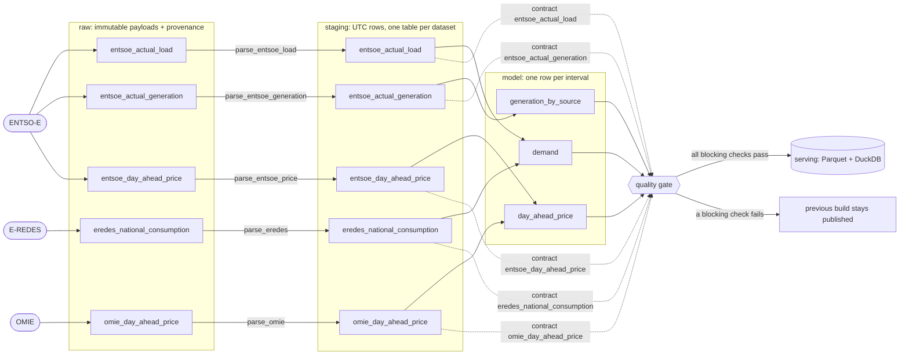

# Lineage

Generated by `pt-energy lineage diagram` from the pipeline definition (dataset specs, contracts and
the SQL of each modelled table). Do not edit by hand: CI fails if this file is out of date.

## Pipeline



Solid arrows are data. Dotted arrows are contracts: they define what the staging tables must look
like, and the quality gate generates its checks from them.

## From a number back to its raw file

Every modelled row carries `raw_sha256`. `meta.lineage` maps that hash to the raw file, when it was
fetched, the git SHA of the code, and the contract version:

```sql
SELECT p.interval_start_utc, p.price_eur_mwh, l.path, l.fetched_at, l.pipeline_version
FROM model.day_ahead_price p JOIN meta.lineage l ON l.content_sha256 = p.raw_sha256
WHERE p.source = 'omie' ORDER BY p.interval_start_utc DESC LIMIT 1;
```

The file at `l.path` (under the data folder) is the publisher's payload, byte for byte. OpenLineage
events for every build are written to `lineage/openlineage/<batch_id>.jsonl`.
